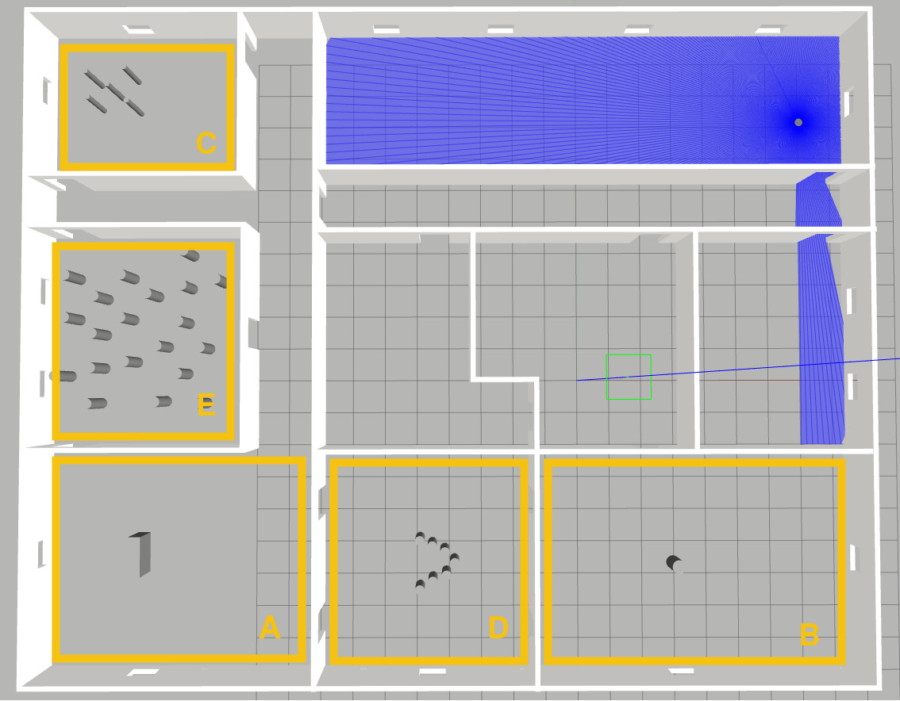

# ROS Navigation Tutorial: Local Planner
## Before Starting

### Start configuration
#### Docker container of the course
  - Set up the environment by following the Docker guide **[SETUP_TP.md](https://gitlab.com/cpelyon/rob_ressources/ros2_cuda_gazebo.docker/-/blob/main/SETUP_TP.md)** (steps 0 to 4): Docker image, workspace, submission repository, container launch.
    - Do **not** `git clone` this repository: add it to your submission repository with `git subtree add` (guide, step 2, `tp_nav`).
    - Everything is already installed in the container and the ROS environment is already set (`RMW_IMPLEMENTATION=rmw_cyclonedds_cpp`, ROS limited to your machine, `TURTLEBOT3_MODEL=waffle`): no `apt install` or `export` needed.
  - Launch the container from the root of your workspace, and run it again to open other terminals in the same container:
    ```
    ./run_tp.sh
    ```
  - In the container, compile your workspace (it builds `training_remap_pkg`):
    ```
    cd /root/student_ws
    colcon build --symlink-install
    source install/setup.bash
    ```
  - Path of this training repository in the container (to set in each new terminal):
    ```
    export TRAINING_NAV=/root/student_ws/src/training-turtlebot-simulator-student
    ```

#### Start simulation for Navigation
- Launch simulator without navigation (if you want to see gazebo GUI add `headless:=False`)
  ```
  ros2 launch nav2_bringup tb4_simulation_launch.py headless:=False params_file:="$TRAINING_NAV/training-nav2-controller/params/nav2_params_local_DWB.yaml" map:="$TRAINING_NAV/training-nav2-controller/maps/base_line_local.yaml" world:="$TRAINING_NAV/training-nav2-controller/worlds/baseline_for_local_planner.sdf" x_pose:=0.0 y_pose:=0.0 z_pose:=0
  ```
  
- On rviz set "2d pose estimate" 

- Start the Mapper node to send command to simulated robot (in another terminal: `./run_tp.sh`)

  ```
  ros2 run training_remap_pkg remapper --ros-args -p input_topic:=/cmd_vel_fake -p output_topic:=/cmd_vel
  ```

## 1. Introduction

The following document presents an incremental overview of the different ROS  controller server configuration (old local planner configuration )
Before starting have a look to the following resources:
 - ROS 2 [Nav2 Controller Server](https://docs.nav2.org/configuration/packages/configuring-controller-server.html)
 - ROS 2 [Nav2 general concepts](https://docs.nav2.org/concepts/) documentation
 - ROS [Nav2 costmap_2d](https://docs.nav2.org/configuration/packages/configuring-costmaps.html) documentation
 - ROS [Nav2 costmap_2d github](https://github.com/ros-navigation/navigation2/tree/main/nav2_costmap_2d) package

Example of expected result:

[](https://www.youtube.com/watch?v=kudmGqGd-3o)


## 2. Start simulation env.


- Follow the instructions provided in the section **Start Simlation for navigation**.

- Check that in the env. is correctly load into gazebo (env. plus robot).

- Check that the robot is correctly localized (AMCL green arrow).


- Try to ask a navigation throught riz
    1. Relocate the robot using the **2D Pose Estimate** tool if needed
    1. Ask goal with the **2D Nav Goal** tool

>  - What means the path with arrows path ?
> -  What means the blue path ?


## 3. Navigation Loop

To test the different configuration of local planner, we will first create a node **nav_loop.py** allowing the robot to reach the point A, and when reached go to the B pt. When the pt B is reached robot needs to navigation again to the point A.

1. Create a new package nav_loop in the `src` folder of your workspace (it will be part of your submission repository)
```
cd /root/student_ws/src
ros2 pkg create --build-type ament_python --license Apache-2.0 --node-name nav_loop nav_loop
```

2. Create the **nav_loop.py** 
3. Complete this file such as the created node use `BasicNavigator` to send a goal and check if the goal is reached or not (follow the recommandation  here [https://docs.nav2.org/commander_api/index.html](https://docs.nav2.org/commander_api/index.html))
4. the point A should have the following configuration
```
{'header':{'frame_id':'map'},'pose':{'position':{'x':-0.1222,'y':-5.526},'orientation':{'z':0,'w':1}}}
```

5. the point B should have the following configuration
```
{'header':{'frame_id':'map'},'pose':{'position':{'x':6.45,'y':-5.526},'orientation':{'z':1,'w':0}}}
```

Tips: Do not forget to update the `console_scripts` in the `setup.py`.

## 4. Play with DWA Local Planner

In the following section, the different DWA parameters are studied.
For each different env. configuration the following parameters have to be updated (detailed information is available here [https://docs.nav2.org/configuration/packages/configuring-dwb-controller.html](https://docs.nav2.org/configuration/packages/configuring-dwb-controller.html))
- PathDist.scale
- GoalDist.scale
- PathAlign.scale
- GoalAlign.scale
- BaseObstacle.scale
- RotateToGoal.scale

- Start the dynamic configuration edition with the following command:
  
  ```
  ros2 run rqt_reconfigure rqt_reconfigure
  ```
- In the following window, select only **contoller_server**
- all presented parameters can be modified and modifications are automatically apply to the current planner

The planner would be tested into the following areas:



>[NOTE!]
> Dynamic parameters are not supported by the actual `controller_server` for applying your modification you need to modify `nav2_params_local.yaml` file and restart simulation

### 4.1 Simple known Obstacle Avoidance
- **Into gazebo**, move  your robot into the room A
<!-- - **Into rviz**,  update the **2D estimate pose** of the robot to fit the environment  -->
- Update your **nav_loop.py** file with the following point 

- the point A :
```
{'header':{'frame_id':'map'},'pose':{'position':{'x':-15,'y':-5.12},'orientation':{'z':0,'w':1}}}
```

  - the point B :

```
{'header':{'frame_id':'map'},'pose':{'position':{'x':-12.1,'y':-5.12},'orientation':{'z':1,'w':0}}}
```

- Change the parameter **GoalDist.scale** by **10.0** value
- Execute several goals
- What happen ? Why

- Set parameter **GoalDist.scale** to **1.0** and change the **PathDist.scale** value by **10.0** value
- Execute several goals
- What happen ? Why

- Set parameter **PathDist.scale** to **1.0** and change the **BaseObstacle.scale** value by **10.0** value
- Execute several goals
- What happen ? Why

- Execute several goals
- What happen ? Why

- FInd the optimal parameter configuration for this situation

### 4.2 Simple unknown Obstacle Avoidance
- **Into gazebo**, teleport your robot into the room B
- **Into rviz**,  update the **2D estimate pose** of the robot
- Update your **nav_loop.py** file with the following point 

- the point A :
```
{'header':{'frame_id':'map'},'pose':{'position':{'x':-0.14,'y':-5.53},'orientation':{'z':0,'w':1}}}
```

  - the point B :

```
{'header':{'frame_id':'map'},'pose':{'position':{'x':4.43,'y':-5.53},'orientation':{'z':1,'w':0}}}
```
- Restore your DWA initial configuration

- Change the parameter **GoalDist.scale** by **10.0** value
- Execute several goals
- What happen ? Why

- Set parameter **GoalDist.scale** to **1.0** and change the **PathDist.scale** value by **10.0** value
- Execute several goals
- What happen ? Why

- Set parameter **PathDist.scale** to **1.0** and change the **BaseObstacle.scale** value by **10.0** value
- Execute several goals
- What happen ? Why

- Set parameter **PathDist.scale** to **10.0** and change the **PathAlign.scale** value by **10.0** value
- Execute several goals
- What happen ? Why

- FInd the optimal parameter configuration for this situation


### 4.3 Complex known Obstacles Avoidance
- **Into gazebo**, teleport your robot into the room C
- **Into rviz**,  update the **2D estimate pose** of the robot
- Update your **nav_loop.py** file with the following point 

- the point A :
```
{'header':{'frame_id':'map'},'pose':{'position':{'x':-15.4,'y':9.27},'orientation':{'z':0,'w':1}}}
```

  - the point B :

```
{'header':{'frame_id':'map'},'pose':{'position':{'x':--13,'y':9.27},'orientation':{'z':1,'w':0}}}
```
- Restore your DWA initial configuration

- Change the parameter **GoalAlign.scale** by **10.0** value
- Execute several goals
- What happen ? Why

- Set parameter **GoalAlign.scale** to **1.0** and change the **PathDist.scale** value by **10.0** value
- Execute several goals
- What happen ? Why

- Set parameter **PathDist.scale** to **1.0** and change the **PathAlign.scale** value by **10.0** value
- Execute several goals
- What happen ? Why

- Set parameter **PathAlign.scale** to **1.0** and change the **GoalAlign.scale** value by **10.0** value
- Execute several goals
- What happen ? Why

- Tips: try to update also the parameter **sim_time** (e.g 5.0) and test again your configurations.

- FInd the optimal parameter configuration for this situation


### 4.3 Complex unknown Obstacles Avoidance
- **Into gazebo**, teleport your robot into the room D
- **Into rviz**,  update the **2D estimate pose** of the robot
- Update your **nav_loop.py** file with the following point 

- the point A :
```
{'header':{'frame_id':'map'},'pose':{'position':{'x':-6.61,'y':-5.39},'orientation':{'z':1,'w':0}}}
```

  - the point B :

```
{'header':{'frame_id':'map'},'pose':{'position':{'x':-2.76,'y':-5.39},'orientation':{'z':0,'w':1}}}
```
- Restore your DWA initial configuration

- Play with different parameters to allow your robot to cross such obstacle

- Tips: try to update also the parameter **sim_time** (e.g 5.0) and test again your configurations.

- Find the optimal parameter configuration for this situation


## 5. Play with MPPI Local Planner
- Stop the simulator and start it again with the following configuration

```
  ros2 launch nav2_bringup tb4_simulation_launch.py headless:=False params_file:="$TRAINING_NAV/training-nav2-controller/params/nav2_params_local_MPPI.yaml" map:="$TRAINING_NAV/training-nav2-controller/maps/base_line_local.yaml" world:="$TRAINING_NAV/training-nav2-controller/worlds/baseline_for_local_planner.sdf" x_pose:=0.0 y_pose:=0.0 z_pose:=0
```

- In the following section, the different MPPI parameters are studied.
For each different env. configuration the following parameters have to be updated (detailed information is available here [https://docs.nav2.org/configuration/packages/configuring-mppic.html#mppi-parameters](https://docs.nav2.org/configuration/packages/configuring-mppic.html#mppi-parameters))
  - batch_size
  - time_steps
  - model_dt
  - Constraint Critic
  - Goal Critic
  - Obstacles Critic
  - Path Align Critic
  - Path Follow Critic
  - Prefer Forward Critic


- Tips : 
  - In order to see trajectories add the related markers inside Rviz
  - To see the trajectories and the selected trajectories on a given situation, do not hesitate to stop the `training_remap_pkg remapper` node

### 5.1 MPPI Controller parameters
- Based on the tests carried out with DWA, vary the parameters relating to the MPPI controller (batch_size, time_steps, model_dt) in order to observe the impact on the proposed trajectories.
- Provide screenshots showing the impact of these parameters.


### 5.2 Critic parameters

### 5.2.1 Obstacle/Cost Critics
- Based on the tests carried out with DWA, vary the parameters relating to the `obstacle` and `cost` critics in order to observe the impact on the proposed trajectories.
- Provide screenshots showing the impact of these parameters.

### 5.2.2 Path Critics
- Based on the tests carried out with DWA, vary the parameters relating to the `Path Align`, `Path Angle` and `Path Follow` critics in order to observe the impact on the proposed trajectories.
- Provide screenshots showing the impact of these parameters.


### 5.2.3 Goal Critics
- Based on the tests carried out with DWA, vary the parameters relating to the `Goal`, `Goal Angle` critics in order to observe the impact on the proposed trajectories.
- Provide screenshots showing the impact of these parameters.


### 5.2.4 Behavior Critics
- Based on the tests carried out with DWA, vary the parameters relating to the `Constraint`, `Prefer Forward` and `Twirling` critics in order to observe the impact on the proposed trajectories.
- Provide screenshots showing the impact of these parameters.


## 6. Create your own local Planner
coming soon...


<!-- 
## 7. Gazebo Tips:
Depending of your configuration, some parameters should be ajusted to get the current world correctly running.
- Click on **physics** field:


- You can play with 2 criteria to optimize gazebo behavior
  - **real time update rate** :  parameter specifies in Hz the number of physics updates that will be attempted per second. If this number is set to zero, it will run as fast as it can.
  - **max step size** :  specifies the time duration in seconds of each physics update step.

  (more information is available at [http://gazebosim.org/tutorials/?tut=modifying_world](http://gazebosim.org/tutorials/?tut=modifying_world)

-->
  


